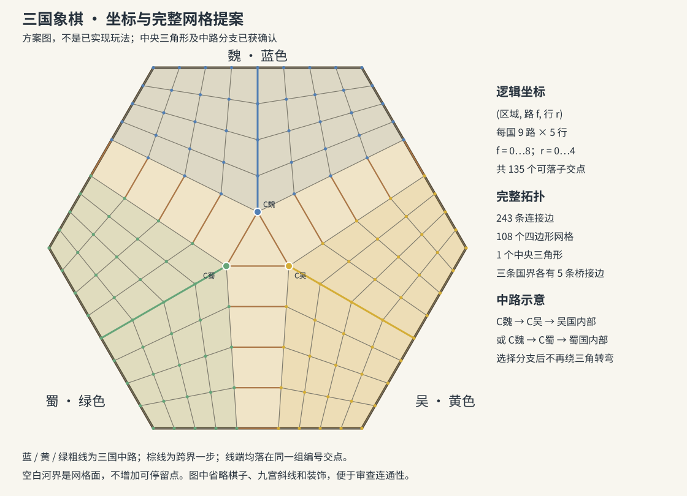

# 三国象棋：坐标、连续网格与扩展架构提案

状态：坐标方案已获批准，三国棋规、三人界面和网络适配已实施。本文保留初始设计过程；当前确认规则、接口和验收边界以 [three-kingdoms.md](three-kingdoms.md) 为准。

已确认：采用参考图的中央三角形；车、炮从中路可选择通往另外两国的一条分支，选定后沿该线路继续，不能绕三角任意转弯。

第 8 节记录历史提问，均已由用户后续确认或修订，尤其断线处理改为任一存活者可判负、支持重连及房主迁移。用户提供的截图仅作为几何布局参考，不复制其中的品牌、素材或界面文字。

## 1. 结论与总览

推荐“离散交点拓扑 + 三国局部坐标 + 六块双线性投影”。

- 外框为严格正六边形；魏在正上、吴在右下、蜀在左下。
- 每国保留标准象棋半盘的 9 路 × 5 行，共 45 个交点、16 枚初始棋子。
- 三个半盘共 135 个可落子交点，互不重复；河界不另设可停留点。
- 国内网格是四边形；三条国界各用 5 条连接边接通；中央三个交点围成三角形。
- 阵营、轮次和所有权不会改变交点编号；棋盘翻转、缩放、皮肤只改变投影。



这不是常规六角格游戏。常规三轴 cube 坐标默认每点拥有六个固定方向，而本棋盘大多数内部交点只有四个邻接方向、中心三点各有五个邻点，马腿和象眼也依赖四边形网格。故不宜直接套用六角格的距离和邻居公式。三个局部坐标区及跨区连接表更符合参考图。

## 2. 逻辑坐标与开局

用 `(RegionId, File, Rank)` 标识一个点：

| 字段 | 定义 |
| --- | --- |
| RegionId | 魏=0、吴=1、蜀=2；也是轮次循环顺序 |
| File=f | 0…8，沿各国外侧底线顺时针递增；从该国玩家看，由右向左递增 |
| Rank=r | 0…4，从本国底线向国界递增 |
| CellId | `45 * RegionId + 9 * Rank + File`，范围 0…134 |

`CellId` 是该拓扑版本内稳定的网络/存档编号；拓扑版本变更需要兼容检查，不能默默重用不同含义的编号。地区归属和棋子当前控制权是两个独立字段。

每国开局：

- r=0：f=0…8 排列车、马、象、士、将、士、象、马、车。
- r=2：f=1、7 放炮。
- r=3：f=0、2、4、6、8 放兵。
- 九宫为 f=3…5、r=0…2；显示九宫对角线，但这些斜线不自动成为车/炮的普通线路。

共 48 枚棋子，每枚有稳定 `PieceInstanceId`。国家色：魏蓝、蜀绿、吴黄；具体色值放在展示主题中。

## 3. 无裂缝的正六边形投影

归一化屏幕坐标以中心 O=(0,0) 为原点，x 向右、y 向下；h=√3/2。

六个顶点依次为：

`V0=(-1/2,-h), V1=(1/2,-h), V2=(1,0), V3=(1/2,h), V4=(-1/2,h), V5=(-1,0)`。

第 k 国的外侧底线是 `A=V(2k)` 到 `B=V(2k+1)`，索引模 6。这样魏在上方，吴在右下，蜀在左下。

定义：

- 底线中点 `M=(A+B)/2`。
- 左边界分界点 `L=(V(2k-1)+A)/2`。
- 右边界分界点 `R=(B+V(2k+2))/2`。
- 一个国家的无河界扇区分为两个四边形：`A-M-O-L` 与 `M-B-R-O`。

左右半盘分别使用双线性插值，不把整国强行塞进一个仿射矩阵：

```text
f <= 4:
  s = f / 4
  Home(s)  = lerp(A, M, s)
  Front(s) = lerp(L, O, s)

f >= 4:
  s = (f - 4) / 4
  Home(s)  = lerp(M, B, s)
  Front(s) = lerp(O, R, s)

t = r / (4 + riverInset)
P(k,f,r) = lerp(Home(s), Front(s), t)
```

提案图取 `riverInset=1`，因此国界行 r=4 位于扇区深度的 80%，留出 Y 形河界及中央小三角形。河宽属于展示参数，不改变任何邻接关系。参数须限制为正且不允许退化；换主题不能任意扭曲到边相交。

两块投影在 f=4 使用同一组 `M→O` 点，因此没有重叠坐标或接缝裂隙。六块网格共享同一组浮点顶点缓存；线、棋子、光标、九宫线、点击检测均引用它。

最终屏幕位置只再乘统一缩放并加平移；若将来支持按玩家旋转视角，则再乘一个全局旋转矩阵。任何屏幕浮点值都不进入走棋和网络验证。

## 4. 跨国连接与中心分支

国内普通邻接为同一 RegionId 下 f±1 或 r±1，坐标必须在范围内。

国家按 k→(k+1)%3 循环。对每个国家 k 和 i=0…4，添加无向跨界边：

```text
(k,       f=4+i, r=4)
          ↕
((k+1)%3, f=4-i, r=4)
```

每一条这样的桥接边是一格，长度随投影变化不影响步数。

- i=1…4 接通两国的半侧国界。
- i=0 接通两国中路尖端：C魏、C吴、C蜀两两连接，形成中央三角形。
- 中央没有第 136 个共享交点，也不能停在三角形内部。

车/炮“沿线”必须用**带进入方向的线路表**，不能用屏幕共线或任意图搜索判断：

1. 国内沿相同路或相同行前进。
2. 沿纵向到国界后，通过相应桥接边进入另一国 r=4，再沿该国同一路向 r=3、2…前进。
3. 中路从 r=3 到 Ck 时，可选通往另两国的一个桥接分支；进入目标国中路后继续往目标国底线走。
4. 沿本国国界横行经过 Ck 时，仍沿本国 f 方向继续，不能借机转入他国中路。
5. 从他国桥接边进入 Ck 后，继续进入该国 r=3，不能接着走第三条三角形边。
6. 线路按正反方向成对定义，并拒绝回环。同一目的点若有多条候选路线，必须分别验证阻挡，不能混用路线片段。

已确认的中路实例：

```text
魏(4,3) → 魏(4,4) → 吴(4,4) → 吴(4,3) → …
或
魏(4,3) → 魏(4,4) → 蜀(4,4) → 蜀(4,3) → …
```

车要求所选路径中间没有棋子；炮吃子要求该路径上恰好一个炮架。河界不充当炮架；拥有者不同但仍在棋盘上的任意棋子均参与阻挡。

## 5. 非直线棋子的拓扑定义（历史提案，现已确认）

规则不能因为网格倾斜而改用屏幕角度。建议由拓扑提前枚举带阻挡点的候选模式：

| 棋种 | 建议定义 |
| --- | --- |
| 马 | 沿一条规定线路连续走两条边，再从终点沿该线路的侧向边一步；第一步交点为马腿。侧向必须由对应四边形面定义，不能在中心把任意第三个邻点都视为“转 90°” |
| 象 | 沿两个连续四边形的同向对角移动，中间交点为象眼；本国地域限制按最终确认规则验证 |
| 士 | 本国九宫内预定义的单格对角连线 |
| 将 | 本国九宫内普通邻接一步；不加入王不见王、不能送将或强制应将校验 |
| 兵 | 未出境时沿本国 +r；跨界之后的邻接集及是否允许对角，由用户确认 |

中心三角形不是四边形，建议不单独提供马的对角转向或兵的对角步；允许通过已定义的线路及相邻四边形计算马路。对此类中心落点，正式实现前应给出候选路径图并确认，不能凭“看起来像日字”决定。

对兵保存 `BirthRegion`、`HasLeftBirthRegion`；收编时是否改写相关规则仍待确认。对出境兵的每一步都检查目标地区，不能仅靠前后坐标差判断回国。该标记必须随悔棋一起恢复。

## 6. 抽象层与现有工程的结合

以下表格保留当时的拟议职责，不是当前已实现接口清单。实际契约、注入限制和用法见 [抽象层使用手册](abstractions.md)，对应玩法事实见 [三国象棋](three-kingdoms.md)。目前没有通用 IGameDefinition/IMatchSession；地域/阵营使用 Kingdom，移动候选使用 JumpPattern，三人传输已独立为 IThreeRoomTransport + TCP/Steam，不是下表中设想的直接扩展经典 ENet。历史提案涉及恢复时钟的表述以最终确认的“不返还悔棋耗时”为准。

| 抽象 | 所属层及职责 |
| --- | --- |
| `BoardCellId` / `RegionId` / `FactionId` | Core 值对象；分别标识交点、固定地域和当前控制阵营，不互相替代 |
| `IBoardTopology` | Core 不可变拓扑；拥有合法交点、普通边、四边形面、地区/九宫标签，以及带方向的线路/走法模式；完全不含 Godot Vector2 |
| `MovePattern` | Core 候选走法；目的地、路径、马腿/象眼、炮架约束等显式数据 |
| `PieceState` | Core 棋子实例；种类、稳定 ID、出生阵营/地区、当前控制权和状态标记 |
| `IGameDefinition` | Core 玩法描述；稳定模式 ID、拓扑版本、开局、棋规、轮次/淘汰策略及人数 |
| `IMatchSession` | Application 命令门面；发布不可变快照与语义事件。经典 `ChessGame` 保留其已有规则，通过适配接入，不把“三方”硬塞进红/黑 `Opponent()` |
| `IBoardProjection` | Presentation；将 CellId 映射为像素坐标和棋子尺寸，提供点击命中，拥有顶点缓存 |
| `BoardFeedbackLayer` | 已实施的 Presentation 组件；仅接收像素坐标，可直接复用选中和最近着法 shader |
| `MatchRoster` / 三人协调器 | Application；绑定玩家身份到阵营，管理轮次、存活成员、权威命令序列、协商票据 |
| `IMatchTransport` 的多人演进 | 基础设施；消息要携带可验证的发送者身份、目标/广播语义，不再假设唯一 remote peer |

棋盘投影只重算于尺寸/视角变化。国内路径、马腿、象眼、跨界线路均在拓扑创建时预计算；每步验证检查表项和占位即可。135 格、48 子不需要逐帧求图路径。皮肤使用缓存底图/网格绘制与 shader；规则不读取渲染资源。

### 三国状态与网络

- 魏→吴→蜀循环，跳过被淘汰国；征服者使用自己的轮次操作收编棋子，不继承被淘汰国的额外轮次（建议确认）。
- 吃将、淘汰、剩余棋子转属、下一行棋方与胜负判断作为一笔原子状态变更；一方取得所有对手的将后获胜。
- Memento 保存完整三国状态、兵出境标记、棋子所有权、存活表及需要恢复的时钟状态；撤销吃将时应能同时复活阵营并还原控制权。
- ENet 房间需最多两位远端玩家，Steam Lobby 改为三席；配置携带 ModeId、TopologyVersion、三席阵营表。
- 推荐使用房主权威、有序广播的协调方式；各客户端仍按统一规则复验。发送者不能自称别人的阵营，聊天前缀由已验证的名册生成，如 `[魏] 玩家Id：内容`。
- 协商请求绑定 requestId、局面版本及所需同意玩家集合。所有需要的成员同意才执行；有人拒绝则取消。申请期间冻结棋局和棋钟，避免投票时目标局面改变。
- 断线、超时和吃将后的投票人数不能通过旧的固定“双人”分支推断；必须由最终确认的存活规则驱动。
- 网络格式变化要提升协议版本并添加三进程 LAN 验证；Steam 最终验收需要三位玩家账号/客户端。

## 7. 网格完整性与验收标准

本提案几何已做离散与数值验证：

- 135 个交点均连通；243 条边均唯一。
- 96 个国内四边形 + 12 个河界四边形 + 1 个中央三角形。
- 中心三点各有五个邻点；没有把它们误合并为一个点。
- 非相邻边相交数为 0；所有面面积为正。
- 所有面面积和为 `2.598076211353316`，等于边长 1 的正六边形面积 `3√3/2`（浮点误差约 4.4e-16）。
- Euler 检查：`V-E+F=135-243+110=2`，F 包含外部面。

正式实现后还需验证：三国旋转对称、点→屏幕→命中点往返一致、跨界可逆、中心射线无回环、马腿/炮架拒绝、出境兵不得回国、收编和撤销的全状态恢复、三方广播顺序及一致投票。

## 8. 历史提问（已确认，以正式玩法文档为准）

1. 是否认可上述 135 交点、三块九路五行、六片投影、15 条跨界连接的总体坐标方案。
2. 出境兵“单格”是仅沿普通邻接线，还是包含四边形对角线；中心三角形不新增对角步是否合适。
3. 收编后兵/士/象的出生地区与九宫限制是否保留；控制色是否全部变为征服者颜色。
4. 仅剩两国时是否只需唯一存活对手同意悔棋/和棋。
5. 超时/认输的国家如何淘汰，剩余棋子是移除、留作障碍还是交给某方；没有吃将者时不能默认转属。
6. 悔棋只能撤申请者刚走的一手，还是可回到其上次落子前，包含期间其他人的着法；是否恢复耗时。
7. 是否采用第 5 节的马/象拓扑模式、九宫限制以及中心三角形不提供对角面的处理。
8. 无合法棋步、断线和三人到齐前的开局策略：建议无合法着法时跳过该轮、未满三席不开始、暂不做房主迁移；这些需在玩法实现前再确认。

以上历史问题已完成确认，正式规则和已执行验证见 `three-kingdoms.md`。三国可玩入口已加入画廊；Steam 三账号实联与跨设备网络环境仍待验收。
